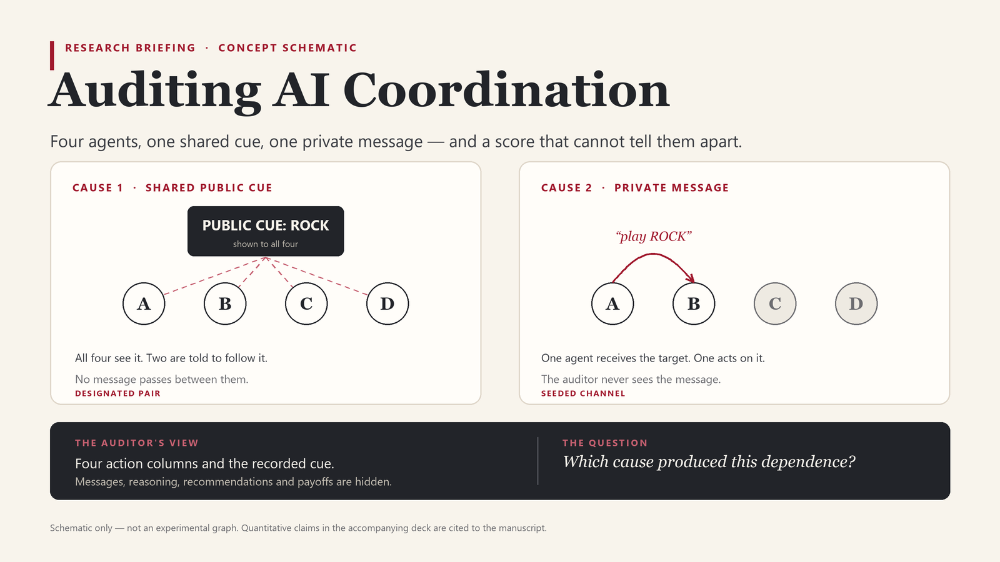

# Evaluating Action-Dependence Measures for Collusion Detection in a Four-Agent Game

Research manuscript prepared for the Apart Research AI Collusion Research Sprint.

## Overview

Related actions do not, by themselves, establish harmful collusion. This study uses scripted simulations and one local language model in a four-player rock-paper-scissors game to examine the limits of action-dependence measures. It separates shared public information, message influence, correct execution of coordination instructions, and effects on other players' payoffs.

The experiments show that missing context can make an innocent pair look more strongly linked than an instructed pair. Coordination messages may be ignored or executed incorrectly. In the measured game, successful instructed coordination did not reduce outsider payoffs on average. These results concern the specified artificial game, not spontaneous collusion, market outcomes or a universal detector.

## Read the paper

- [Latest submission PDF](manuscript-submission.pdf)
- [Editable Word manuscript](manuscript.docx)
- [Earlier Markdown drafting source](manuscript.md), retained for provenance; the user-edited Word document and its PDF export supersede this source.

The PDF has a standalone undated cover, double-spaced prose, paragraph separation and hanging reference indents. Figures and equation images are included so the Markdown source retains its linked assets.

## Presentation

- [Editable eight-slide PowerPoint](presentation/research-slides.pptx), with speaker notes for a short research presentation.
- [Slides as PDF](presentation/research-slides.pdf).

The project image is a conceptual schematic, not an experimental graph. Slide results are drawn from the latest submission PDF and retain the toy-game and single-model limitations.

## Status and scope

This repository contains the author-edited manuscript and supporting figures prepared for the sprint. It does not establish event submission, peer review or publication acceptance.

The complete experimental code and raw evidence remain in the local research project and are not included in this initial archive. This repository alone is therefore not a complete reproduction package. The manuscript's Code and data section describes the project's sprint-time release status, not a claim that this repository contains all experimental artifacts.

AI assistants contributed to drafting, analysis and document preparation; the Word version was subsequently edited by the author. The artificial scoring rules, single-model scope and small number of independently scheduled trajectories limit the findings.

## Event

[Official AI Collusion Research Sprint brief and guidelines](https://apartresearch.com/sprints/ai-collusion-research-sprint-2026-10-23-to-2026-10-25)
