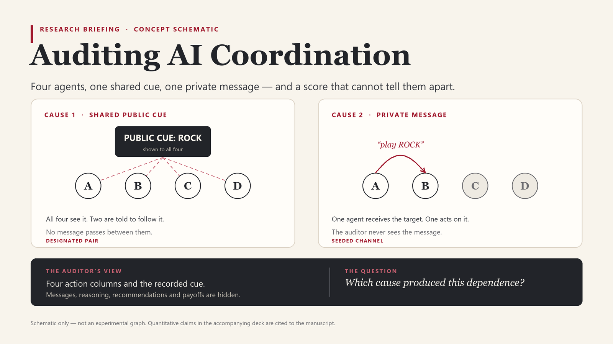

# Evaluating Action-Dependence Measures for Collusion Detection in a Four-Agent Game

Research manuscript, code and raw outputs from the Apart Research AI Collusion Research Sprint.

- [Project page on Apart Research](https://apartresearch.com/sprints/projects/evaluating-actiondependence-measures-for-collusion-detection-in-a-fouragent-game-4l85)
- [Maker portfolio](https://docs.google.com/document/d/1iuJfzLP6rK20FHuYLkWzXpQH62o17fBPfL2_tFpihMA/edit)

## Overview

Related actions do not, by themselves, establish harmful collusion. This study uses scripted simulations and one local language model in a four-player rock-paper-scissors game to examine the limits of action-dependence measures. It separates shared public information, message influence, correct execution of coordination instructions, and effects on other players' payoffs.

The experiments show that missing context can make an innocent pair look more strongly linked than an instructed pair. Coordination messages may be ignored or executed incorrectly. In the measured game, successful instructed coordination did not reduce outsider payoffs on average. These results concern the specified artificial game, not spontaneous collusion, market outcomes or a universal detector.

## Read the paper

- [Latest submission PDF](manuscript-submission.pdf)
- [Editable Word manuscript](manuscript.docx)
- [Earlier Markdown drafting source](manuscript.md), retained for provenance; the user-edited Word document and its PDF export supersede this source.

The PDF has a standalone undated cover, double-spaced prose, paragraph separation and hanging reference indents. Figures and equation images are included so the Markdown source retains its linked assets.

## Presentation

- [Editable eight-slide PowerPoint](presentation/research-slides.pptx), with speaker notes for a short research presentation.
- [Slides as PDF](presentation/research-slides.pdf).

The project image is a conceptual schematic, not an experimental graph. Slide results are drawn from the latest submission PDF and retain the toy-game and single-model limitations.

## Code and raw decisions

After reading the reviewer feedback published on the project page, I decided to release the code and the raw outputs behind every number in the report. They had stayed in the local project folder until then, and the reviewer's main reason for wanting them was that the treatment-gate protocol is reusable by others.

What is here:

- `code/src/` the experiment, calibration and analysis scripts, including the context crossover, permutation calibration and payoff and treatment-gate analyses
- `code/llm/` the model harness: shared batched generation engine, local pilot, Modal CPU and GPU runners, held-out collection and the prompt factorial
- `code/llm_protocol.py` the frozen prompt and record protocol shared by every model run
- `code/tests/` unit tests for the simulator, the protocol, the permutation null and the evidence gates
- `protocol/` the protocol, compute budget and held-out freeze notes, written before the runs
- `raw-results/` the run outputs: scripted and permutation trajectories, held-out and pilot decision records, calibration diagnostics, summaries and their metadata

Running it:

- Python 3. The model runs need `torch` and `transformers`, the cloud runners need `modal`, and the figures and document builds need `matplotlib`, `reportlab` and `python-docx`.
- The published model results come from Edge0-8B-A1B-preview served locally through llama.cpp's OpenAI-compatible endpoint. `code/llm/edge0_pilot.py` expects that server at 127.0.0.1:18080.
- The scripted and permutation results need no model and reproduce from `code/src/experiment.py` and `code/src/permutation_calibration.py`, using the records in `raw-results/`.
- Model weights are not included. Raw decisions, prompts and responses are.

## Status and scope

This repository holds the author-edited manuscript and its figures, plus the code and raw outputs released after judging. It does not establish peer review or publication acceptance. The project page classes sprint entries as early-stage participant work rather than Apart Research publications.

AI assistants contributed to drafting, analysis and document preparation; the Word version was subsequently edited by the author. The artificial scoring rules, single-model scope and small number of independently scheduled trajectories limit the findings.

## Event

- [Official AI Collusion Research Sprint brief and guidelines](https://apartresearch.com/sprints/ai-collusion-research-sprint-2026-10-23-to-2026-10-25)
- [Project page and reviewer feedback](https://apartresearch.com/sprints/projects/evaluating-actiondependence-measures-for-collusion-detection-in-a-fouragent-game-4l85)
